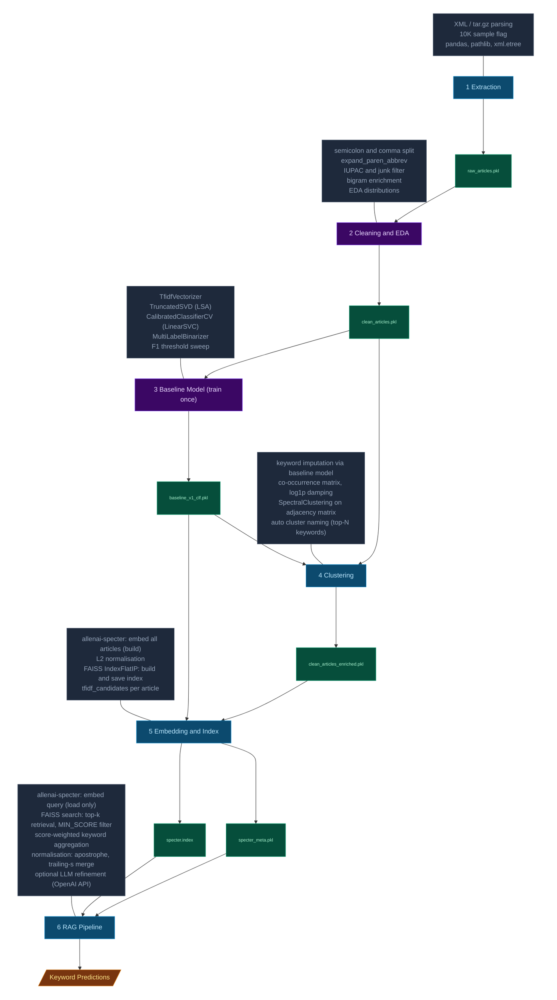

# PMC Scientific Papers — Keyword Prediction Pipeline

| Step | File | Purpose | Key Logic | Packages | Output |
|------|------|---------|-----------|----------|--------|
| 1 | `python/01_data_extraction.py` | Parse PMC XML archives or load 10K sample pickle into flat DataFrame | `USE_10K_SAMPLE` flag bypasses tar.gz extraction | pandas, pathlib, xml.etree | `raw_articles.pkl` — cols: pmcid, title, abstract, keywords, sections |
| 2 | `notebooks/02_cleaning_eda.ipynb` | Keyword cleaning pipeline + exploratory analysis | semicolon/comma split, `expand_paren_abbrev()`, `is_iupac_or_junk()`, `is_standalone_alnum_junk()`, bigram enrichment | pandas, re, unicodedata, matplotlib | `clean_articles.pkl` — cols: kwd_lst, kwd_lst_cl, n_keywords |
| 3 | `notebooks/03_baseline_keyword_prediction.ipynb` (train once) | Train multi-label keyword classifier — used as enhancer for clustering and similarity, not end-user output | TfidfVectorizer → TruncatedSVD (LSA) → CalibratedClassifierCV(LinearSVC) → MultiLabelBinarizer, F1 @ threshold sweep | sklearn | `baseline_v1_clf.pkl` — bundle: tfidf, svd, clf, mlb |
| 4 | `python/02_enrich_cluster_labels.py` | Assign semantic domain cluster per article via keyword co-occurrence | 1. Impute keywords for sparse articles via baseline model; 2. Sparse co-occurrence matrix, log1p damping; 3. SpectralClustering on adjacency; 4. Auto-name clusters from top-N keywords (prefix dedup for 3+ word terms) | scipy.sparse, sklearn SpectralClustering | `clean_articles_enriched.pkl` — cols: cluster_label, cluster_name, cluster_confidence, kwd_imputed |
| 5 | `python/03_enrich_tfidf_candidates.py` | Add baseline-predicted keyword candidates per article; build FAISS semantic index for similarity retrieval | Part A: baseline model → top-k tfidf_candidates per article; Part B: allenai-specter embeds "title [SEP] abstract" → L2-normalised → IndexFlatIP | sentence-transformers, faiss-cpu, tqdm | `clean_articles_enriched.pkl` + tfidf_candidates, `specter.index`, `specter_meta.pkl` |
| 6 | `python/04_rag_pipeline.py` | Core end-user feature: RAG-based keyword prediction for new papers via semantic retrieval | 1. Embed query (allenai-specter); 2. FAISS top-k, MIN_SCORE filter; 3. Score-weighted aggregation: kwd_lst_cl x2xscore, tfidf_candidates x1xscore, direct TF-IDF x1.5; 4. Keyword normalisation; 5. Optional LLM refinement (OpenAI API) | faiss-cpu, sentence-transformers, openai, python-dotenv | retrieval_keywords, direct_tfidf, llm_keywords (console / JSON) |
